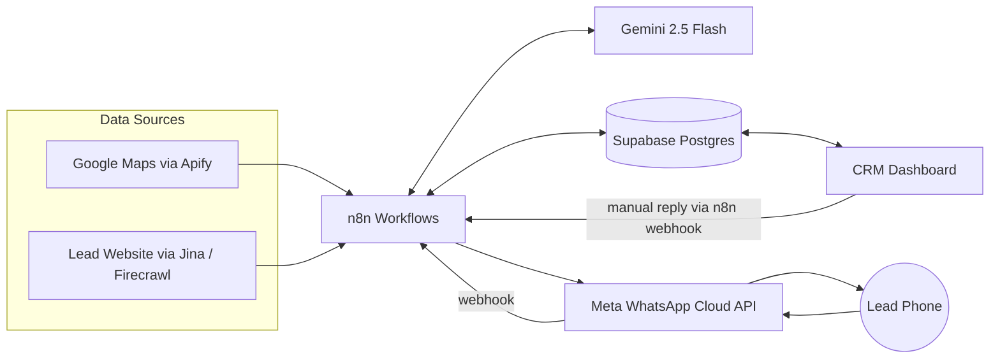

# architecture.md - System Architecture

## Components
| Component | Role |
|---|---|
| n8n (self-hosted) | Orchestrator. Runs all workflows, schedules, API calls |
| Apify (Google Maps Scraper) | Finds businesses |
| Jina Reader (main), Firecrawl (backup) | Turns websites into clean text |
| PageSpeed Insights API (optional) | Mobile speed score |
| Google Gemini 2.5 Flash / Flash-Lite | Critic, copywriter, reply classifier |
| Meta WhatsApp Cloud API | Send and receive WhatsApp messages |
| Supabase (Postgres, Auth, Realtime, Storage) | CRM database and dashboard backend |
| CRM Dashboard (React + Tailwind + Supabase JS) | Inbox, approval queue, pipeline, settings |
| Telegram bot (optional) | Alerts and daily report |

## Diagram

## Design principles
1. **Supabase is the source of truth.** n8n has no memory. If n8n crashes, nothing is lost.
2. **Safe to run twice (idempotent).** Unique keys: `place_id`, `phone_e164`, `wa_message_id`. Check status before every action.
3. **Many small workflows.** One job each. They talk only through lead statuses in the database.
4. **Two-pass AI.** Critic gives facts as JSON. Copywriter only sees the critic JSON, never raw website text.
5. **AI never invents facts.** Evidence is required for every flaw.
6. **Human in the loop first.** Auto-send stays off until quality is proven.
7. **Kill switch and caps.** `settings.sending_enabled`, `daily_cap`, send hours.
8. **Log everything.** `lead_events` and `error_log`.

## Workflows (n8n)
| ID | Name | Trigger | Job |
|---|---|---|---|
| WF-01 | Prospecting | Schedule 22:00 IST | Pick campaign, run Apify, clean, dedupe, insert leads |
| WF-02 | Enrichment | Schedule 23:00 IST | Health probe, read pages, code checks, save audit |
| WF-03 | Analyze and Draft | Schedule 01:00 IST | Gemini critic and copywriter, quality gate, save draft |
| WF-04 | Sender | Every 15 min, 10:00 to 18:00 IST | Check kill switch, hours, cap, consent. Send templates with gaps |
| WF-05 | Inbound Webhook | Webhook | Verify signature, log replies and statuses, classify, notify, opt-out |
| WF-06 | CRM Send | Webhook from dashboard | Verify owner login, check 24h window, send, log |
| WF-07 | Follow-ups | Daily 11:00 IST | One polite follow-up after 3 days, max 2 |
| WF-08 | Error Handler | Error Trigger | Write `error_log`, alert |
| WF-09 | Daily Report | Daily 19:00 IST | Summary to Telegram or email |
| WF-10 | Health Monitor | Hourly | Failure rate, token check, stuck leads, circuit breaker |

Heavy work runs at night. Messages are sent in the daytime. Set n8n timezone to `Asia/Kolkata`.

## Deployment
- n8n in Docker (Postgres or SQLite) on a small VPS or free-tier VM.
- Public HTTPS URL is required for WhatsApp webhooks (Caddy or Cloudflare Tunnel).
- Dashboard hosted on Vercel, Netlify or Cloudflare Pages.
- Supabase hosted project. Weekly backup. Free projects can pause when inactive.
- Docker restart policy `always`. Pin the n8n image version.
- Keep a **staging** copy (Meta test number + test Supabase project).

## Security
- Secrets only in n8n credentials or environment variables.
- Service role key stays in n8n. Dashboard uses anon key + owner login + RLS.
- Dashboard never calls WhatsApp directly. It calls an n8n webhook with the owner's Supabase token.
- Verify `X-Hub-Signature-256` on every WhatsApp webhook POST (raw body + App Secret).
- Reply 200 fast, then process. Deduplicate by `wa_message_id`.
- Treat scraped website text as untrusted data (prompt injection).
- Permanent system-user token for WhatsApp, not the 24-hour test token.

## Fail-safes
| Risk | Safeguard |
|---|---|
| Sending without consent | Consent Gate in WF-04 |
| Double send | Create message row first, unique `wa_message_id`, no blind retry on send |
| False AI claim | Evidence rule, quality gate, human approval |
| Many failures | Circuit breaker: more than 5 failed sends in 30 min sets `sending_enabled = false` and alerts |
| STOP ignored | Keyword match first, AI second, `opted_out` checked in every query |
| API rate limits | Wait nodes, backoff retry, fallback providers |
| Server down | State is in DB. Workflows resume from statuses |

## Model and API versions
Keep model names and Graph API version in one place (`settings` and n8n variables) so they are easy to change.
- Analysis: `gemini-2.5-flash`
- Classification: `gemini-2.5-flash-lite`
