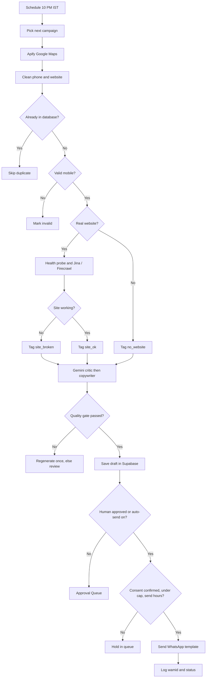

# flow.md - End-to-End Flow

## Pipeline for one lead

## Phase 1 - Prospecting (Apify)
1. n8n Schedule Trigger starts at 22:00 IST.
2. Pick the active campaign that ran longest ago.
3. Call Apify Google Maps Scraper (30 to 50 places while on free credits).
4. Clean each item in a Code node:
   - Phone to E.164 (`+91XXXXXXXXXX`). Only mobiles starting with 6 to 9 are valid. Landlines are marked invalid.
   - Website: social or directory links (facebook, instagram, justdial, linktr.ee and so on) do NOT count as a website.
5. Insert with `on conflict (place_id) do nothing`.
6. Branch:
   - **Path A: has website** -> `lead_type = unknown`, go to Phase 2.
   - **Path B: no website** -> `lead_type = no_website`, create an audit row with `site_state = none`, skip scraping.
7. Update `campaigns.last_run_at`.

Edge cases: chains (group by website host), permanently closed places (skip), empty results (log and move on), Apify failure (retry once, log, alert).

## Phase 2 - Enrichment (Jina / Firecrawl)
1. Claim 3 to 5 `new` leads with a website.
2. Health probe: GET homepage, 10 to 15 s timeout, follow redirects, record status, final URL, time.
3. Decide `site_state`:
| Observation | site_state |
|---|---|
| DNS fail, refused, timeout | broken |
| HTTP 4xx or 5xx | broken |
| SSL error | broken (ssl) |
| Parked or for-sale page | broken (expired) |
| Text under about 300 chars, or "coming soon" | empty |
| Captcha or bot block | blocked (do not claim broken) |
| 200 OK with real content | ok |
4. Re-test a "broken" site once, a few minutes later. Only call it broken if both fail.
5. Read up to 3 pages: homepage, About, Services. Jina first. Firecrawl if text is too short or the site needs JavaScript. Trim to about 6,000 characters.
6. Code checks: HTTPS, viewport tag, copyright year, phone or WhatsApp link, booking button, testimonials, response time.
7. Optional: PageSpeed Insights mobile score.
8. Save to `website_audits`. Set lead to `enriched`.

## Phase 3 - Analysis and copywriting (Gemini)
1. **Critic** (temp 0.2 to 0.3, JSON only): finds flaws with evidence, strengths, best angle, score, language.
2. **Copywriter**: sees only the critic JSON. Returns template variables `var1`, `var2`, `var3`, plus `reply_draft`, `language`, `template`.
3. **Quality gate**: valid JSON, length limits (var2 max 140, var3 max 120), evidence exists, no banned words, no URLs or phone numbers, name match. Fail once -> regenerate. Fail twice -> `review`.
4. Save the draft in `messages` (`is_ai_draft = true`, `status = queued`). Lead goes to `review` (auto-send off) or `queued` (auto-send on and consent confirmed).

Templates: `pitch_no_site_v1`, `pitch_site_broken_v1`, `pitch_site_ok_v1`. First message must be an approved template with variables.

## Phase 4 - Outreach (WhatsApp Cloud API)
Send rules (WF-04):
1. Kill switch on, inside send hours, weekday.
2. Under the daily cap (warm-up: week 1 = 10 to 20 per day, then slowly up).
3. Lead is `queued`, not opted out, `consent_status = confirmed`.
4. Create the message row first, then POST to WhatsApp once. No blind retry.
5. Save `wamid`, set `sent`, set `next_follow_up_at` to +3 days.
6. Random wait of 30 to 90 seconds between sends.

Webhook (WF-05):
1. GET: verify token, return `hub.challenge`.
2. POST: check signature, reply 200 fast.
3. Status events update `messages` (sent, delivered, read, failed).
4. Inbound message: find lead by phone, insert message, open the 24h window, STOP keyword check, classify with Gemini Flash-Lite, notify owner.

## Reply flow

```mermaid
sequenceDiagram
  participant L as Lead
  participant W as WhatsApp Cloud API
  participant N as n8n Webhook
  participant S as Supabase
  participant G as Gemini
  participant O as Owner (CRM)
  L->>W: Replies on WhatsApp
  W->>N: POST webhook
  N->>N: Verify signature, dedupe by wamid
  N->>S: Insert inbound message, open 24h window
  N->>G: Classify intent
  G-->>N: intent + confidence
  alt stop
    N->>S: opted_out = true, cancel follow-ups
  else interested or question
    N->>S: status = replied, alert owner
    S-->>O: Realtime update
    O->>N: Manual reply
    N->>W: Send free-form text
    W->>L: Delivered
  end
  W->>N: Status webhook
  N->>S: Update message status
```

| Intent | Action |
|---|---|
| stop | `opted_out = true`, cancel follow-ups, send nothing more |
| interested / question | Alert owner, show AI reply draft, human sends |
| not_interested | Stop follow-ups |
| wrong_number | Mark phone invalid |
| other / low confidence | Leave for the owner |

## Phase 5 - Orchestration and follow-ups
- WF-07: if read or delivered with no reply after 3 days, send one follow-up template. Max 2, 4 to 5 days apart. Never follow up on opted-out or not-interested leads or active chats.
- WF-10 hourly health check can trip the circuit breaker.
- WF-09 sends the daily report at 19:00 IST.

## 24-hour window
- Lead replies -> `window_expires_at = now + 24h`. Free-form text is allowed.
- After the window closes -> only approved templates. The CRM shows a banner and a template picker.

## Consent route (so WhatsApp sends stay allowed)
The agent still researches and writes the pitch. The first touch goes through a channel that needs no WhatsApp opt-in, then the lead starts the chat or confirms consent:
1. Email with a click-to-chat link (`wa.me/NUMBER?text=...`)
2. Phone call, then ask permission
3. Click-to-WhatsApp ads
4. Landing page form with an unticked opt-in box
5. Manual DM on social, then move to WhatsApp
6. Referrals and existing clients

When consent arrives, set `consent_status = confirmed` and `consent_source`. The lead then moves to `queued`.
